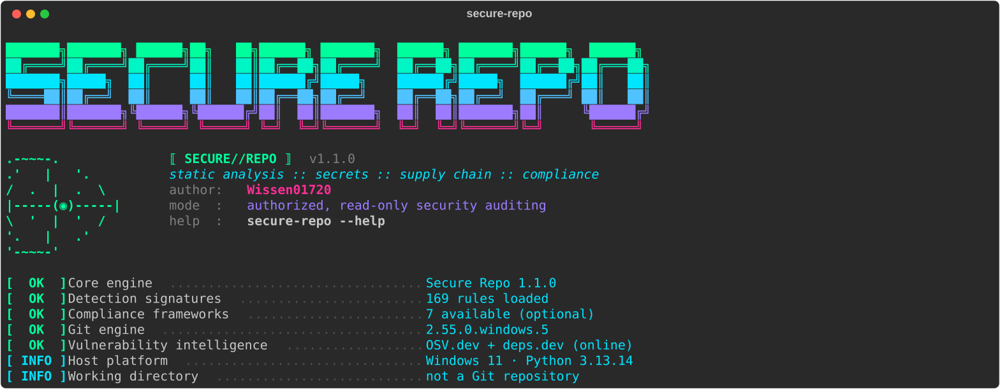
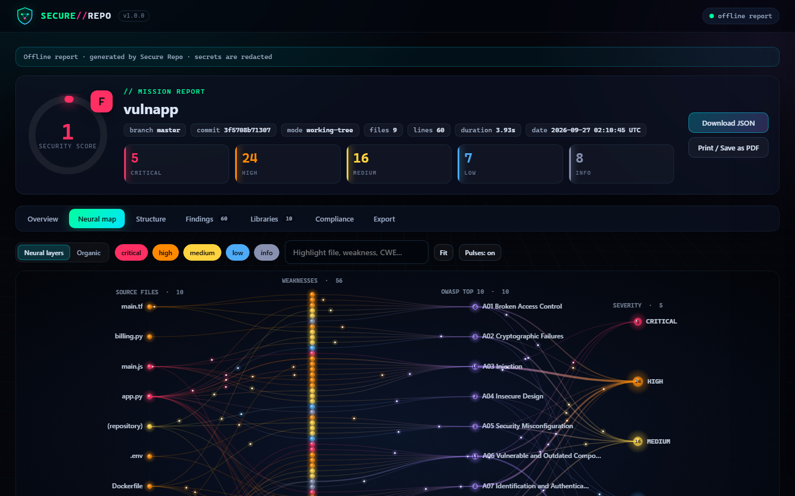

<div align="center">

# SECURE//REPO

**Repository security auditor with a command-line console and a neural-map GUI.**

Static code analysis · secret detection · library & supply-chain intelligence · repository structure mapping ·
optional compliance evidence (OWASP, PCI DSS, ISO 27001, SOC 2, GDPR, HIPAA, NIST SSDF)




[Español](README.es.md) · [Documentation](#documentation) · [Changelog](CHANGELOG.md)

</div>

---

## What it does

Point it at a Git repository (the one you are in, a local path or a Git URL, including private ones) and it audits it
**read-only**: it never runs the audited code and never installs its dependencies.

| Capability | Details |
|---|---|
| **Static analysis** | 175 rules for Python, JavaScript/TypeScript, Java/Kotlin, C#, PHP, Go, Ruby, C/C++, Rust, shell, Dockerfiles, Kubernetes, Terraform and CI pipelines. Python gets syntax-tree analysis with taint tracking, JavaScript/TypeScript a data-flow pass. |
| **Secrets** | Cloud keys, tokens, private keys, connection strings, high-entropy credentials, sensitive files. Always redacted in the output. |
| **Libraries** | 25+ manifest and lock formats; every library checked against OSV.dev and deps.dev; versions resolved even without a lockfile. Private package names can be kept off the network. |
| **Reports** | A timestamped folder with HTML, JSON, SARIF, Markdown, CSV, a CycloneDX SBOM and an integrity manifest, written outside the audited repository by default. |
| **Console and GUI** | A live terminal dashboard (`--theme plain` for a sober one) and a local web app with a neural map and a structure treemap that explain each weakness and its fix. |
| **CI-friendly** | `--fail-on`, `--baseline` (fail only on new findings), `--since origin/main` (only changed files), SARIF for code scanning. |
| **Learns from you** | Mark false positives and accepted risks once; they are re-applied on every scan. |
| **Optional compliance evidence** | Maps findings to 7 frameworks as supporting evidence, never as a certification. |

## Quick start

```bash
git clone https://github.com/Wissen01720/Secure_Repo.git
cd Secure_Repo
./run.sh scan /path/to/repo        # Windows: .\run.bat scan C:\path\to\repo
./run.sh gui                       # the graphical interface
```

The launcher creates a private virtual environment on the first run. Inside a Git repository, `./run.sh` alone opens
the interactive console. Python 3.10 or newer and Git are required. More options (pipx, from source, updating):
[Installation](docs/installation.md).

```bash
secure-repo scan . --yes --plain --no-menu --baseline baseline.json --fail-on high     # a CI gate for new problems only
```

## How accurate is it?

Measured on code the authors did not write: four public projects pinned to a commit (NodeGoat, DVPWA,
Vulnerable-Flask-App and the clean library `requests`), every finding reviewed by hand.

| | Result |
|---|---|
| Precision, findings of medium/high confidence | **73 %** |
| Precision, every finding (tests and low confidence included) | 60 % |
| Documented weaknesses found | **26 of 28 (93 %)** |

Small sample, so read it as a floor of evidence and not as a guarantee: the details, the misses and how to reproduce
it are in [How the analysis works](docs/analysis.md#how-accurate-is-it-measured-on-third-party-code). The limits of
a static analyzer (what it cannot see) are in [Privacy, trust model and limitations](docs/security-model.md).

## Documentation

| Document | What is in it |
|---|---|
| [Installation](docs/installation.md) | Requirements, launchers, pipx, from source, in-place updates |
| [Command-line guide](docs/cli-guide.md) | Step by step walkthrough, CI/CD usage, private and organization repositories |
| [How the analysis works](docs/analysis.md) | Engines, accuracy, languages, scoring, false-positive reduction, compliance |
| [Command and report reference](docs/reference.md) | Every flag and every file of a report folder |
| [Graphical interface](docs/gui.md) | The neural map, structure boxes, triage and downloads |
| [Privacy, trust model and limitations](docs/security-model.md) | What leaves your machine, how the audited repository is treated, suppressions, limits |
| [Troubleshooting](docs/troubleshooting.md) | Common problems and fixes |
| [Development](docs/development.md) | Project layout, tests, adding a rule |
| [Releasing](docs/releasing.md) | Versions, tags, GitHub releases and publishing to PyPI |

<p align="center"></p>

## Rules of engagement

> **Only audit repositories you own or have explicit, written permission to assess.**

Secure Repo is built for defenders and enforces that posture:

- It **never executes** the audited code, never installs its dependencies and never exploits a finding.
- It asks you to **confirm your authorization** before every engagement (`--yes` confirms it in automation).
- Detected secrets are **redacted** in the terminal, the GUI and every report.
- Git runs hardened: hooks disabled, `ext::` transport blocked, shallow clones, LFS downloads skipped.

Using the tool to steal information or for any malicious purpose is forbidden by the [license](LICENSE).

## License

Copyright © 2026 **Wissen01720**. All rights reserved.

Secure Repo is distributed under the **Secure Repo Ethical Source-Available License**: you may use it, study it
and use its reports (also inside your company) for lawful, authorized security work. You may **not** use it to
access code without permission, steal or misuse the information it finds, attack systems, remove the
attribution, claim authorship, sell it or publish modified versions without permission. Read the full
[LICENSE](LICENSE). It is *source-available*, not open source: if your organization requires an OSI-approved license,
contact the author.
